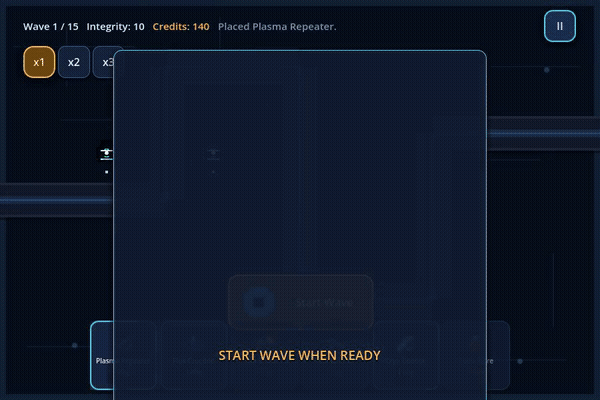
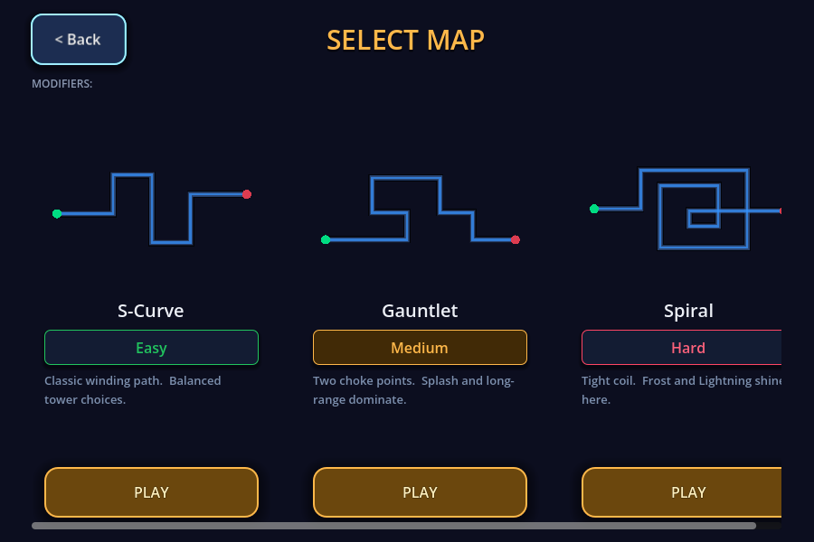
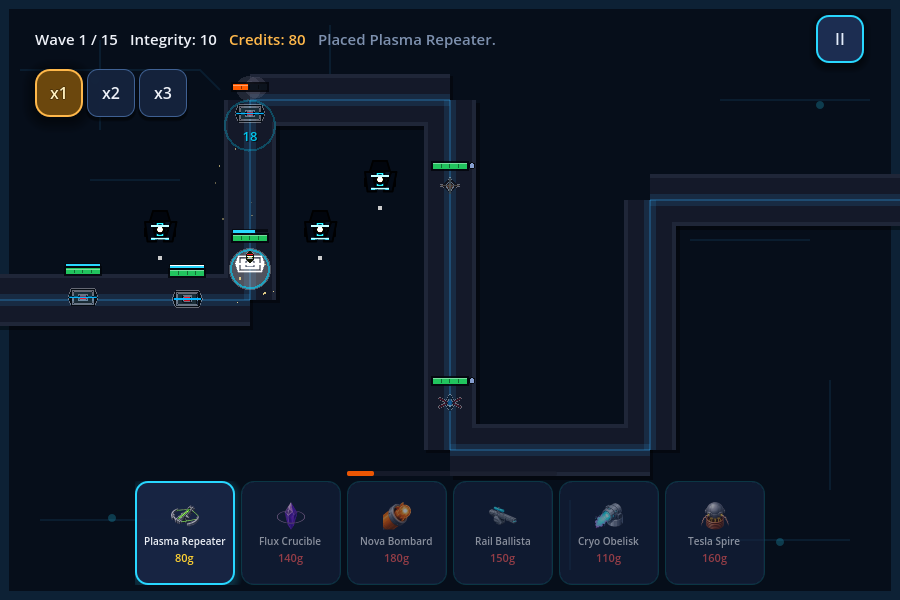

# ManaNet

Cyber-themed tower defense game — Godot 4.6 port of the Python/Kivy TowerDefenseKivy.

## Watch a scripted gameplay demo

[](docs/showcase/gameplay.mp4)

[Watch/download the full ~21-second MP4](docs/showcase/gameplay.mp4) ·
[Capture source, method, and limits](docs/showcase/README.md)

Real Godot 4.6.2 rendering from the shipped scenes: menu → map selection →
three normal-cost Plasma Repeaters → the first wave on S-Curve. AI-operated
scripted actions run the actual simulation; the clip is silent and uses fixed
30 FPS movie time. It is a local demo, not an online playable build.

| Choose a route | Deploy and defend |
| --- | --- |
|  |  |

Place six types of energy-weapon towers, earn Credits through combat, and
protect your Cyber-Deck across a 15-wave run. This capture shows the opening
wave only; it does not claim a full-game clear or Android-device verification.

### Try it locally

Open `project.godot` in **Godot 4.6.2**, import its resources, and press **F5**
to start the main menu. Or from the repo root:

```sh
godot --path . --editor --import
godot --path .
```

> **Status: proprietary.** This repository is public for source visibility and
> transparency. It is **not open source** — there is no license grant to reuse,
> modify, or redistribute this code. See [LICENSE](LICENSE).

- **Stack:** Godot 4.6, GDScript
- **Package:** com.mananet.godottd
- **Build:** Open in Godot 4.6 Editor
- **Docs:** [docs/](docs/)
- **Agent instructions:** [AGENTS.md](AGENTS.md) (sole authority)
- **Project context:** [docs/PROJECT_CONTEXT.md](docs/PROJECT_CONTEXT.md)

## Setup and verification

The verification toolchain is pinned to **Godot 4.6.2**. Install Godot 4.6.2
and make it available to the verifier in either of two portable ways:

- set the `GODOT_BIN` environment variable to the Godot 4.6.2 executable, or
- put a Godot 4.6.2 binary named `godot` on your `PATH`.

No absolute workstation paths are required; the checkout can live anywhere
(including paths with spaces). From the repository root:

```sh
# Full functional audit — exits 0 clean, 1 on any failure
python tools/verify_game.py

# Headless boot smoke test
python tools/verify_game.py --quit

# Test-only negative control: injects one deliberate failure; must exit 1
python tools/verify_game.py --negative-control

# Exit-status contract tests (clean=0, injected failure=1, missing engine=2)
python tests/verifier_exit/test_verifier_exit.py
```

A failing check always produces a nonzero exit status; a printed PASS
summary is never treated as success.
